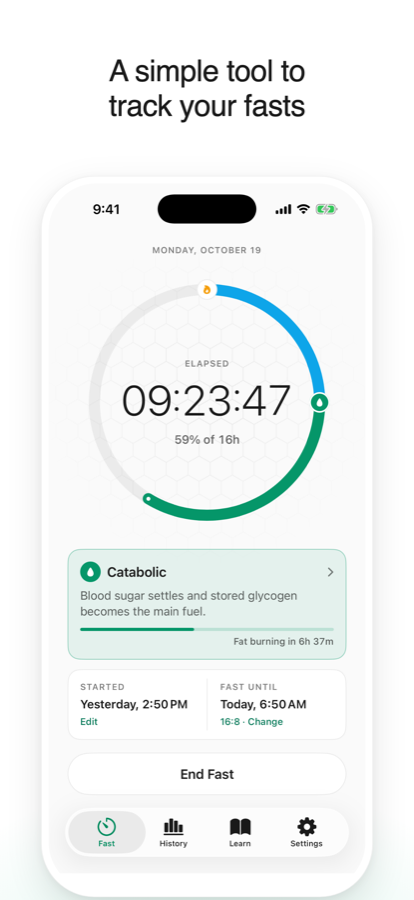
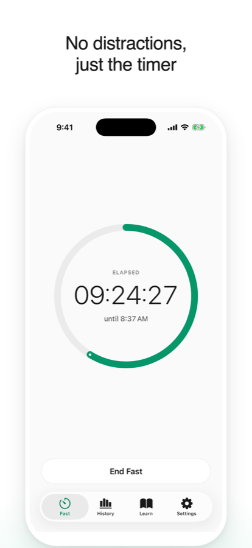
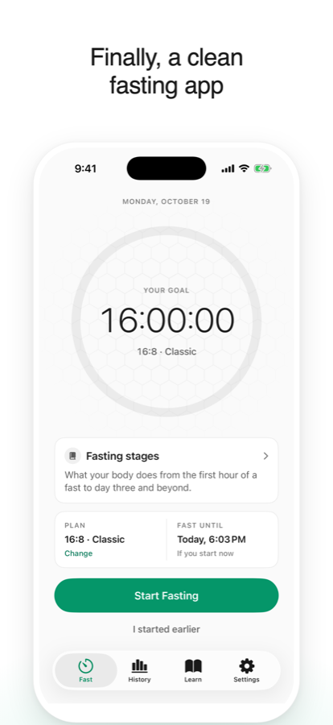
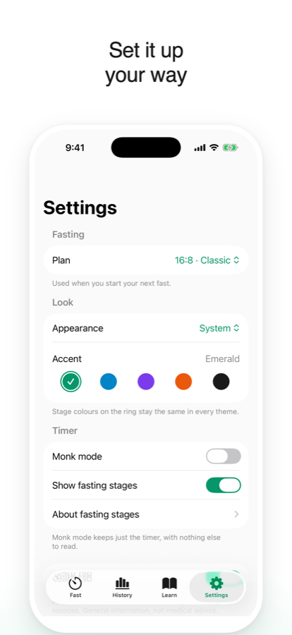
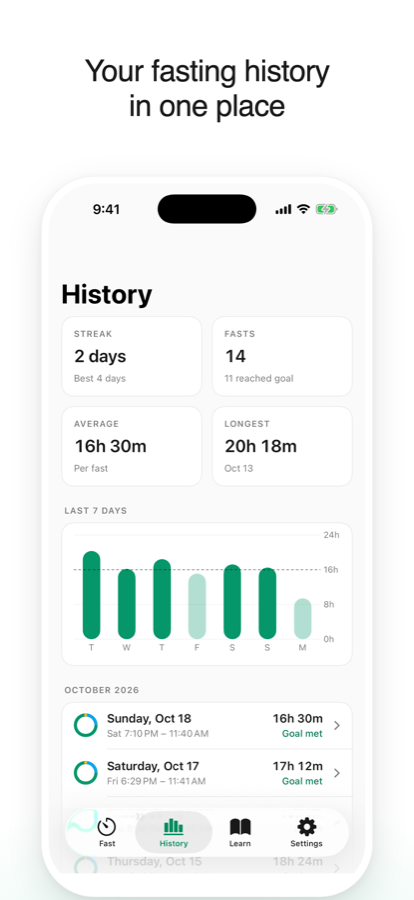

<h1 align="center">Monk Fast</h1>

A simple fasting timer for iPhone. No ads, no account, and the basics are free.

  
  
  
  
  

  <a href="https://monkfast.github.io/support.html">Support</a> ·
  <a href="https://monkfast.github.io/privacy.html">Privacy</a>

